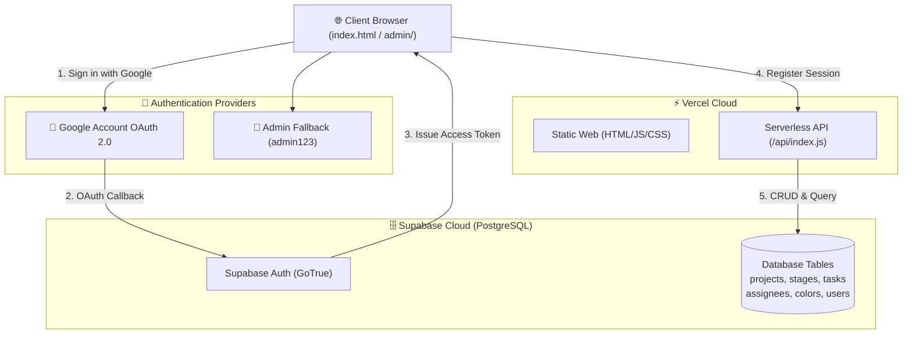

# เอกสารชุดข้อมูลและข้อกำหนดสำหรับ Codex (Codex Work Package)
# RM-Retail POS Project Management (Vercel + Supabase + Google Login)

เอกสารนี้รวบรวมข้อกำหนดทางเทคนิค โครงสร้างสถาปัตยกรรม ขั้นตอนการตั้งค่า Google OAuth ข้อมูลฐานข้อมูล และชุดข้อมูลแผนงานทั้งหมดที่สกัดจาก `Project Detail Work Plan RM-Retail POS V2.0_20261015.xlsx` (จำนวน 237 รายการ) เพื่อให้ **Codex** หรือนักพัฒนาสามารถนำไปปฏิบัติการต่อหรือ Deploy ได้อย่างถูกต้องและครบถ้วน 100%

---

## 1. ข้อมูลภาพรวมโครงการ (Project Overview)

- **ชื่อโครงการ**: RM-Retail POS Project Detailed Work Plan (JIFFY POS)
- **ช่วงเวลาดำเนินงาน**: **11 พฤษภาคม 2026 ถึง 30 กันยายน 2027** (ระยะเวลา 364 วันทำการ / ~17 เดือน)
- **ความคืบหน้ารวมปัจจุบัน (% Complete)**: **16.97%** (สถานะโครงการ: `Late`)
- **เทคโนโลยีเป้าหมาย (Tech Stack)**:
  - **Hosting / Compute**: Vercel Serverless Functions (Node.js 20+)
  - **Database**: Supabase (PostgreSQL 15+)
  - **Authentication**: Google Account Login (Google OAuth 2.0 via Supabase Auth) + Fallback Admin JWT Cookie
  - **Frontend**: Vanilla JavaScript SPA, Dynamic Gantt CSS Grid, Responsive Dashboard



---

## 2. ขั้นตอนการตั้งค่า Google Account Login (Google OAuth Setup)

เพื่อให้ระบบสามารถล็อกอินเข้าสู่ระบบผ่าน Google Account ได้ ต้องจัดเตรียมกุญแจเชื่อมต่อระหว่าง Google Cloud และ Supabase ดังนี้:

### ขั้นที่ 2.1: สร้าง OAuth 2.0 Credentials บน Google Cloud Console
1. เข้าไปที่ [Google Cloud Console](https://console.cloud.google.com/)
2. สร้างโปรเจกต์ใหม่ หรือเลือกโปรเจกต์ที่มีอยู่แล้ว
3. ไปที่ **APIs & Services** -> **OAuth consent screen**
   - User Type: เลือก **External** แล้วกด **Create**
   - App Name: `RM-Retail Project Management`
   - User support email: อีเมลของผู้ดูแลระบบ
   - Developer contact information: ใส่อีเมลผู้ดูแลระบบ
   - Scopes: เลือก `.../auth/userinfo.email` และ `.../auth/userinfo.profile`
   - บันทึกและเสร็จสิ้น
4. ไปที่ **APIs & Services** -> **Credentials**
   - กดปุ่ม **+ CREATE CREDENTIALS** -> เลือก **OAuth client ID**
   - Application type: เลือก **Web application**
   - Name: `Supabase Google Auth`
   - **Authorized JavaScript origins**:
     - `http://localhost:3000` (สำหรับทดสอบในเครื่อง)
     - `https://your-project.vercel.app` (URL ของ Vercel)
   - **Authorized redirect URIs** (สำคัญมาก):
     - `https://<YOUR-SUPABASE-PROJECT-ID>.supabase.co/auth/v1/callback`
   - กด **Create** แล้วคัดลอก **Client ID** และ **Client Secret** เก็บไว้

### ขั้นที่ 2.2: เปิดใช้งาน Google Provider บน Supabase Dashboard
1. เข้าสู่ระบบ [Supabase Dashboard](https://supabase.com/dashboard)
2. ไปที่โปรเจกต์ของคุณ -> เมนู **Authentication** -> **Providers**
3. ค้นหา **Google** และเปิดสวิตช์เป็น **Enabled**
4. วางค่า:
   - **Client ID**: นำค่า Client ID จาก Google Cloud มาวาง
   - **Client Secret**: นำค่า Client Secret จาก Google Cloud มาวาง
5. กด **Save**

---

## 3. รายการตัวแปรสภาพแวดล้อม (Environment Variables Checklist)

ตั้งค่าตัวแปรเหล่านี้ในไฟล์ `.env.local` สำหรับรันในเครื่อง และใส่ใน **Vercel Project Settings > Environment Variables**:

| Variable Name | Required | Description | Example Value |
| :--- | :---: | :--- | :--- |
| `SUPABASE_URL` | **Yes** | Project URL จาก Supabase | `https://abcdefghijklm.supabase.co` |
| `SUPABASE_SERVICE_ROLE_KEY` | **Yes** | Service Role Secret Key (สำหรับ Backend CRUD) | `eyJhbGciOi...` |
| `SUPABASE_ANON_KEY` | **Yes** | Public Anon Key จาก Supabase | `eyJhbGciOi...` |
| `JWT_SECRET` | **Yes** | สตริงสุ่มความยาว 32+ ตัวอักษรสำหรับเซ็น Token | `nigiwai_secret_jwt_random_key_2026` |
| `PORT` | Optional | พอร์ตสำหรับ Local Server (ค่าเริ่มต้น 3000) | `3000` |

---

## 4. โครงสร้างฐานข้อมูลใหม่ (Database Schema Specifications)

ฐานข้อมูลได้รับการอัปเกรดให้รองรับข้อมูล WBS ครบทุกฟิลด์ โดยเก็บไว้ที่ [`supabase_schema.sql`](supabase_schema.sql):

### 4.1 ตาราง `projects`
| Column | Type | Constraints / Default | Description |
| :--- | :--- | :--- | :--- |
| `id` | BIGINT | PRIMARY KEY IDENTITY | รหัสโครงการ |
| `name` | VARCHAR(255) | NOT NULL | ชื่อโครงการ |
| `description` | TEXT | NULL | คำอธิบายโครงการ |
| `assignee` | VARCHAR(255) | NULL | ผู้รับผิดชอบหลัก |
| `status` | VARCHAR(50) | DEFAULT 'Active' | สถานะโครงการ |
| `wbs` | VARCHAR(50) | DEFAULT '0' | รหัส WBS (0 สำหรับ Root Project) |
| `percent_complete` | NUMERIC(5,2) | DEFAULT 0.00 | เปอร์เซ็นต์ความคืบหน้ารวม (16.97%) |
| `created_at` | TIMESTAMPTZ | CURRENT_TIMESTAMP | วันเวลาสร้าง |
| `updated_at` | TIMESTAMPTZ | CURRENT_TIMESTAMP | วันเวลาแก้ไขล่าสุด |

### 4.2 ตาราง `stages` (Major Milestones)
| Column | Type | Constraints / Default | Description |
| :--- | :--- | :--- | :--- |
| `id` | BIGINT | PRIMARY KEY IDENTITY | รหัส Milestone |
| `project_id` | BIGINT | FK -> projects(id) ON DELETE CASCADE | ผูกกับโครงการ |
| `wbs` | VARCHAR(50) | NOT NULL | รหัส Milestone (`1`, `2`, `3`, `4`) |
| `title` | VARCHAR(255) | NOT NULL | ชื่อ Milestone |
| `start_date` | DATE | NOT NULL | วันเริ่มต้นตามแผน |
| `end_date` | DATE | NOT NULL | วันสิ้นสุดตามแผน |
| `duration` | VARCHAR(50) | NULL | ระยะเวลา (เช่น `125 days`) |
| `weight_pct` | INT | DEFAULT 0 | น้ำหนัก Milestone (20%, 20%, 30%, 30%) |
| `percent_complete` | NUMERIC(5,2) | DEFAULT 0.00 | ความคืบหน้าของ Milestone |
| `percent_work_complete` | NUMERIC(5,2) | DEFAULT 0.00 | ความคืบหน้าเนื้องานจริง |
| `status` | VARCHAR(50) | DEFAULT 'Not Started' | สถานะ (`Complete`, `Late`, `Not Started`) |
| `color` | VARCHAR(7) | DEFAULT '#7b879a' | สีประจำ Milestone |
| `sort_order` | INT | DEFAULT 0 | ลำดับการเรียงลำดับ |
| `assignee` | VARCHAR(255) | NULL | ทีมผู้รับผิดชอบ |
| `is_completed` | SMALLINT | DEFAULT 0 | สถานะเสร็จสิ้น (1/0) |

### 4.3 ตาราง `tasks` (WBS Level 2, 3, 4)
| Column | Type | Constraints / Default | Description |
| :--- | :--- | :--- | :--- |
| `id` | BIGINT | PRIMARY KEY IDENTITY | รหัสงานย่อย |
| `stage_id` | BIGINT | FK -> stages(id) ON DELETE CASCADE | ผูกกับ Milestone แม่ |
| `wbs` | VARCHAR(50) | NOT NULL | รหัสลำดับ WBS (เช่น `1.1`, `1.4.1.1`) |
| `title` | VARCHAR(255) | NOT NULL | ชื่องานย่อย |
| `level` | INT | DEFAULT 2 | ระดับความลึก (Level 2, 3, 4) สำหรับจัด Indent |
| `parent_wbs` | VARCHAR(50) | NULL | รหัส WBS แม่ |
| `start_date` | DATE | NOT NULL | วันเริ่มต้นตามแผน |
| `end_date` | DATE | NOT NULL | วันสิ้นสุดตามแผน |
| `duration` | VARCHAR(50) | NULL | ระยะเวลา (เช่น `5 days`, `30 days`) |
| `color` | VARCHAR(7) | DEFAULT '#9fc7ff' | รหัสสีประจำสถานะ |
| `lane` | INT | DEFAULT 1 | เลนบนแผนภูมิ Gantt |
| `assignee` | VARCHAR(255) | NULL | ทีมผู้รับผิดชอบ (`RM`, `VTEC`, `PTTRM`, `AWS`) |
| `sort_order` | INT | DEFAULT 0 | ลำดับจัดเรียง |
| `percent_complete` | NUMERIC(5,2) | DEFAULT 0.00 | เปอร์เซ็นต์ความคืบหน้า (0.00% - 100.00%) |
| `percent_work_complete` | NUMERIC(5,2) | DEFAULT 0.00 | เปอร์เซ็นต์เนื้องานจริง |
| `status` | VARCHAR(50) | DEFAULT 'Not Started' | สถานะ (`Complete`, `Late`, `On Schedule`, `Not Started`) |
| `actual_start` | DATE | NULL | วันที่เริ่มงานจริง |
| `actual_finish` | DATE | NULL | วันที่สิ้นสุดงานจริง |
| `stuck_reason` | TEXT | NULL | สาเหตุความล่าช้า/จุดติดขัด (เมื่อสถานะ Late) |
| `remark` | TEXT | NULL | หมายเหตุเพิ่มเติม |
| `is_completed` | SMALLINT | DEFAULT 0 | 1 เมื่อเสร็จสิ้น, 0 เมื่อยังไม่เสร็จ |

### 4.4 ตาราง `assignees` (ทรัพยากรบุคคล/ทีมงาน)
- 5 ทีมงานหลักที่พบในโครงการ:
  1. `AWS`
  2. `PTTRM`
  3. `RM`
  4. `VTEC`
  5. `VTEC-ROLLOUT`

### 4.5 ตาราง `colors` (ชุดสีประจำสถานะ 4 สี)
| สถานะ | รหัสสี | ความหมาย |
| :--- | :--- | :--- |
| **Complete** | `#77c56b` | งานที่เสร็จสมบูรณ์ 100% |
| **On Schedule** | `#9fc7ff` | งานที่อยู่ระหว่างดำเนินการตามแผน |
| **Late / At Risk** | `#dc3d78` | งานที่ล่าช้ากว่ากำหนด |
| **Not Started** | `#7b879a` | งานที่ยังไม่ถึงกำหนดเริ่ม |

### 4.6 ตาราง `users` (รองรับทั้ง Local Admin และ Google OAuth)
| Column | Type | Constraints / Default | Description |
| :--- | :--- | :--- | :--- |
| `id` | BIGINT | PRIMARY KEY IDENTITY | รหัสผู้ใช้ |
| `username` | VARCHAR(100) | NOT NULL UNIQUE | ชื่อผู้ใช้ระบบ |
| `password` | VARCHAR(255) | NULL | bcrypt hash (เป็น NULL เมื่อล็อกอินผ่าน Google) |
| `display_name` | VARCHAR(150) | NOT NULL | ชื่อที่แสดง |
| `email` | VARCHAR(255) | UNIQUE NULL | อีเมล (จาก Google Account) |
| `google_id` | VARCHAR(255) | NULL | Subject ID จาก Google OAuth |
| `avatar_url` | TEXT | NULL | รูปโปรไฟล์จาก Google |

---

## 5. สรุปชุดข้อมูลนำเข้า (Extracted Dataset Summary)

ชุดข้อมูลทั้งหมดได้รับการสกัดและบันทึกไว้ในไฟล์ [`data/workplan_dataset.json`](data/workplan_dataset.json):

```
โครงการหลัก: RM-Retail POS Project Detailed Work Plan (WBS 0 | 11 พ.ค. 2026 - 30 ก.ย. 2027)
├── Milestone 1: Milestone1 - System Scope (20%) (WBS 1 | 11 พ.ค. 2026 - 30 ต.ค. 2026 | 66.23%)
│   └── ประกอบด้วยงานย่อย 95 รายการ (WBS 1.1 ถึง 1.5.3)
├── Milestone 2: Milestone2 - Implementation (20%) (WBS 2 | 14 ก.ย. 2026 - 19 มี.ค. 2027 | 1.66%)
│   └── ประกอบด้วยงานย่อย 86 รายการ (WBS 2.1 ถึง 2.10)
├── Milestone 3: Milestone3 - Pilot Go-live (30%) (WBS 3 | 1 ก.พ. 2027 - 30 มิ.ย. 2027 | 0.00%)
│   └── ประกอบด้วยงานย่อย 51 รายการ (WBS 3.1 ถึง 3.5)
└── Milestone 4: Milestone4 - Massive Rollout (30%) (WBS 4 | 1 ก.ค. 2027 - 30 ก.ย. 2027 | 0.00%)
    └── ประกอบด้วยงานย่อย 1 รายการ
```

**ยอดรวมทั้งหมด**: 1 โครงการ + 4 Milestones + 233 งานย่อย = **238 แถวข้อมูล (สอดคล้องกับ 237 รายการใน Excel อย่างแม่นยำ)**

---

## 6. โครงสร้างไฟล์และโค้ดในโปรเจกต์ (Codebase File Map)

| ไฟล์ / โฟลเดอร์ | หน้าที่รับผิดชอบ |
| :--- | :--- |
| [`api/index.js`](api/index.js) | Vercel Serverless Function รองรับ 18 Actions (รวม Google OAuth, Timeline, และ CRUD) |
| [`index.html`](index.html) | หน้าแดชบอร์ดหลัก Speedometer Gauge (แสดง 16.97% และโครงการ RM-Retail POS) |
| [`project_timeline.html`](project_timeline.html) | หน้าแสดงแผนภูมิ Dynamic Gantt Chart รองรับ WBS Code, Level Indentation, และ 17 เดือนข้ามปี |
| [`admin/index.html`](admin/index.html) | แผงควบคุมระบบหลังบ้าน รองรับการรับ Callback Google OAuth และแก้ไขข้อมูล WBS |
| [`admin/login.html`](admin/login.html) | หน้าระบบล็อกอินแบบ Dual-Auth (ปุ่ม Google Account OAuth + ฟอร์ม Username/Password) |
| [`data/workplan_dataset.json`](data/workplan_dataset.json) | ข้อมูลแผนงาน 237 รายการสกัดเป็น JSON โครงสร้างสมบูรณ์ |
| [`supabase_schema.sql`](supabase_schema.sql) | สคริปต์ SQL สำหรับสร้างตาราง, RLS, และ INSERT ข้อมูลตั้งต้นทั้งหมดบน Supabase |
| [`scripts/extract_workplan.py`](scripts/extract_workplan.py) | สคริปต์ Python สำหรับสกัดข้อมูลจากไฟล์ Excel เป็น JSON |
| [`scripts/generate_sql.py`](scripts/generate_sql.py) | สคริปต์ Python สำหรับแปลง JSON เป็นคำสั่ง SQL Seed |
| [`local_server.js`](local_server.js) | เซิร์ฟเวอร์จำลองสภาพแวดล้อม Vercel ในเครื่องคอมพิวเตอร์ |
| [`test_api.js`](test_api.js) | ชุดทดสอบความถูกต้องของ API และการเชื่อมโยงระบบ (Automated Test Suite) |
| [`vercel.json`](vercel.json) | การตั้งค่า Routing, CORS และ Rewrites สำหรับ Vercel |

---

## 7. คำสั่งที่ Codex สามารถใช้ทดสอบและเริ่มทำงาน (Codex Execution Commands)

### 7.1 รันชุดทดสอบความสมบูรณ์ของระบบ:
```bash
node test_api.js
```

### 7.2 เริ่มรันเซิร์ฟเวอร์ทดสอบในเครื่อง:
```bash
npm start
```
เปิดดูผลลัพธ์ที่:
- Dashboard: `http://localhost:3000`
- Gantt Chart: `http://localhost:3000/project_timeline.html?project_id=1`
- Admin Login: `http://localhost:3000/admin/login.html`

### 7.3 สกัดและสร้าง SQL ใหม่อัตโนมัติ (หากมีการแก้ไขไฟล์ Excel):
```bash
python scripts/extract_workplan.py
python scripts/generate_sql.py
```

### 7.4 ตรวจสอบการเชื่อมต่อ Supabase จริงเมื่อมี Key:
```bash
node verify_supabase.js [SUPABASE_URL] [SUPABASE_KEY]
```

### 7.5 Deploy ขึ้น Vercel ทันที:
```bash
npx vercel --prod
```
