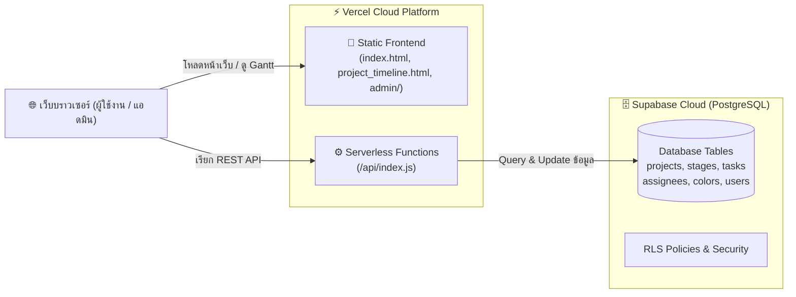

# คู่มือการติดตั้งและ Deploy ระบบขึ้น Vercel โดยใช้ Supabase
# (Vercel + Supabase Deployment Guide)

เอกสารนี้จะแนะนำขั้นตอนการแปลงและนำระบบ **RM-Retail POS Project (JIFFY POS) & Timeline Gantt** ขึ้นใช้งานจริงบนคลาวด์ระดับโปรดักชันด้วย **Vercel** ร่วมกับฐานข้อมูล **Supabase (PostgreSQL)** อย่างละเอียดทีละขั้นตอน

---

## 🏗️ โครงสร้างสถาปัตยกรรมใหม่ (Architecture Overview)



---

## 📋 ขั้นตอนที่ 1: ติดตั้งฐานข้อมูลบน Supabase (Database Setup)

1. เข้าสู่ระบบหรือสมัครสมาชิกที่ [https://supabase.com](https://supabase.com)
2. กดปุ่ม **"New Project"**
   - **Name**: `jffpos-status` (หรือชื่อตามต้องการ)
   - **Database Password**: ตั้งรหัสผ่านฐานข้อมูลและจดบันทึกไว้
   - **Region**: เลือก `Singapore (ap-southeast-1)` (เพื่อให้ความเร็วสูงสุดสำหรับประเทศไทย)
   - กด **"Create new project"** และรอประมาณ 1-2 นาทีจนโปรเจกต์พร้อมใช้งาน
3. ไปที่เมนู **"SQL Editor"** (ไอคอนรูป terminal `>_` ทางแถบเมนูด้านซ้าย)
4. กดปุ่ม **"New query"**
5. เปิดไฟล์ `supabase_schema.sql` ในโฟลเดอร์โปรเจกต์นี้ คัดลอกโค้ด SQL ทั้งหมดมาวางในช่องคำสั่ง
6. กดปุ่ม **"Run"** (หรือกด `Ctrl + Enter`)
   - ระบบจะสร้างตาราง `projects`, `stages`, `tasks`, `assignees`, `colors`, `users`
   - ตั้งค่าความปลอดภัย **Row Level Security (RLS)**
   - นำเข้าข้อมูลเริ่มต้น (Seed Data) ทั้งโครงการเดิม และบัญชีแอดมินให้อัตโนมัติ

---

## 🔑 ขั้นตอนที่ 2: ดึงค่ากุญแจเชื่อมต่อ (Supabase API Keys)

ในหน้าโปรเจกต์ Supabase:
1. ไปที่เมนูล่างซ้าย **"Project Settings"** (ไอคอนรูปฟันเฟือง ⚙️)
2. เลือกหัวข้อ **"API"**
3. คัดลอกค่า 3 ค่าต่อไปนี้เก็บไว้:
   - **Project URL**: (เช่น `https://abcdefghijklm.supabase.co`)
   - **Project API Keys -> `anon` (public)**: สำหรับการเชื่อมต่อทั่วไป
   - **Project API Keys -> `service_role` (secret)**: สำหรับการทำงานฝั่งหลังบ้าน (จำเป็นต้องใช้สำหรับสิทธิ์ CRUD ของ Serverless API)

---

## 💻 ขั้นตอนที่ 3: ทดสอบการทำงานบนเครื่องของท่านก่อน (Local Test)

ก่อนนำขึ้น Vercel ท่านสามารถทดสอบระบบทั้งหมดในเครื่องคอมพิวเตอร์ของท่านได้ทันที:

1. คัดลอกไฟล์ `.env.example` เป็นชื่อ `.env.local`
2. ใส่ค่า Supabase ที่คัดลอกมาลงในไฟล์ `.env.local`:
   ```env
   SUPABASE_URL=https://your-project-id.supabase.co
   SUPABASE_SERVICE_ROLE_KEY=eyJh... (service_role key)
   SUPABASE_ANON_KEY=eyJh... (anon key)
   JWT_SECRET=ใส่ข้อความสุ่มยาวๆ_สำหรับระบบเข้าสู่ระบบ
   PORT=3000
   ```
3. เปิด Command Prompt หรือ PowerShell ในโฟลเดอร์นี้ แล้วรันคำสั่ง:
   ```bash
   npm start
   ```
4. เปิดบราวเซอร์ไปที่:
   - หน้าหลัก Dashboard: [http://localhost:3000](http://localhost:3000)
   - หน้าแอดมิน: [http://localhost:3000/admin/](http://localhost:3000/admin/)
   - ข้อมูลเข้าสู่ระบบเริ่มต้น:
     - **Username**: `admin`
     - **Password**: `admin123`

---

## 🚀 ขั้นตอนที่ 4: Deploy ขึ้น Vercel

สามารถทำได้ 2 วิธีที่สะดวกตามความถนัด:

### วิธีที่ A: Deploy ผ่าน GitHub (แนะนำ สะดวกและอัปเดตอัตโนมัติ)
1. Push โค้ดในโฟลเดอร์นี้ขึ้น GitHub Repository ของท่าน
   ```bash
   git add .
   git commit -m "feat: migrate to vercel serverless and supabase"
   git push origin main
   ```
2. เข้าสู่ระบบ [https://vercel.com](https://vercel.com)
3. กดปุ่ม **"Add New..."** -> **"Project"**
4. เลือก Git Repository ของท่านแล้วกด **"Import"**
5. ในส่วน **"Environment Variables"** ให้เพิ่มตัวแปรต่อไปนี้:
   | Key | Value (ค่าที่ได้จาก Supabase) |
   | :--- | :--- |
   | `SUPABASE_URL` | `https://your-project-id.supabase.co` |
   | `SUPABASE_SERVICE_ROLE_KEY` | *(service_role key จาก Supabase)* |
   | `SUPABASE_ANON_KEY` | *(anon key จาก Supabase)* |
   | `JWT_SECRET` | *(ข้อความสุ่มความยาว 32+ ตัวอักษรสำหรับ Session)* |
6. กดปุ่ม **"Deploy"**
7. รอประมาณ 30-45 วินาที ระบบจะสร้าง Production URL ให้ใช้งานทันที เช่น `https://your-project.vercel.app`

---

### วิธีที่ B: Deploy โดยตรงผ่าน Vercel CLI
หากไม่ต้องการผ่าน GitHub สามารถใช้คำสั่งของ Vercel ได้โดยตรง:
1. ติดตั้ง Vercel CLI (หากยังไม่มี):
   ```bash
   npm i -g vercel
   ```
2. สั่ง Deploy ในโฟลเดอร์โปรเจกต์:
   ```bash
   vercel
   ```
3. ทำตามคำถามบนหน้าจอเพื่อเชื่อมต่อบัญชี Vercel
4. เพิ่ม Environment Variables ใน Vercel Dashboard หรือผ่านคำสั่ง `vercel env add`
5. สั่ง Deploy ขึ้นโปรดักชันจริง:
   ```bash
   vercel --prod
   ```

---

## 🔒 ข้อมูลการเข้าสู่ระบบผู้ดูแลระบบ (Default Credentials)

หลังจากการติดตั้งฐานข้อมูลผ่าน `supabase_schema.sql` บัญชีผู้ดูแลระบบเริ่มต้นคือ:
- **URL เข้าสู่ระบบ**: `/admin/login` หรือ `/admin/login.html`
- **Username**: `admin`
- **Password**: `admin123`

> [!TIP]
> เพื่อความปลอดภัยสูงสุด เมื่อเข้าสู่ระบบใน Production เรียบร้อยแล้ว ท่านสามารถเปลี่ยนรหัสผ่านได้ผ่านทาง Supabase Dashboard หรือสร้างบัญชีแอดมินใหม่

---

## 📁 สรุปไฟล์ที่ถูกแปลงและสร้างขึ้นใหม่ในระบบ

| ไฟล์เดิม (PHP Stack) | ไฟล์ใหม่ (Vercel + Supabase Stack) | คำอธิบาย |
| :--- | :--- | :--- |
| `database.sql`, `update.sql` | `supabase_schema.sql` | สคริปต์สร้างตาราง PostgreSQL, RLS Policies และ Seed Data บน Supabase |
| `api.php`, `config.php` | `api/index.js` | Vercel Serverless Function รองรับ 17 Actions ทั้ง CRUD, Auth, Deep Clone |
| `index.php` | `index.html` | หน้าหลัก แดชบอร์ด Speedometer Gauge และ Project Cards |
| `project_timeline.php` | `project_timeline.html` | หน้าแสดงแผนภูมิ Gantt Chart ไดนามิกข้ามปี |
| `admin/login.php` | `admin/login.html` | หน้าระบบล็อกอินแอดมิน เชื่อมต่อ JWT Cookie แบบไร้รอยต่อ |
| `admin/index.php` | `admin/index.html` | แผงควบคุมระบบหลังบ้าน ลากวาง (Drag & Drop), จัดการสี, โครงการ |
| (ไม่มี) | `vercel.json` | ตั้งค่า Routing, Rewrites ย้อนหลังสำหรับ `.php` และ CORS |
| (ไม่มี) | `local_server.js` | เซิร์ฟเวอร์จำลองเพื่อทดสอบระบบบนเครื่องตัวเองแบบเร็วพิเศษ |
| (ไม่มี) | `package.json` | นิยามไลบรารี `@supabase/supabase-js`, `bcryptjs`, `jsonwebtoken` |
